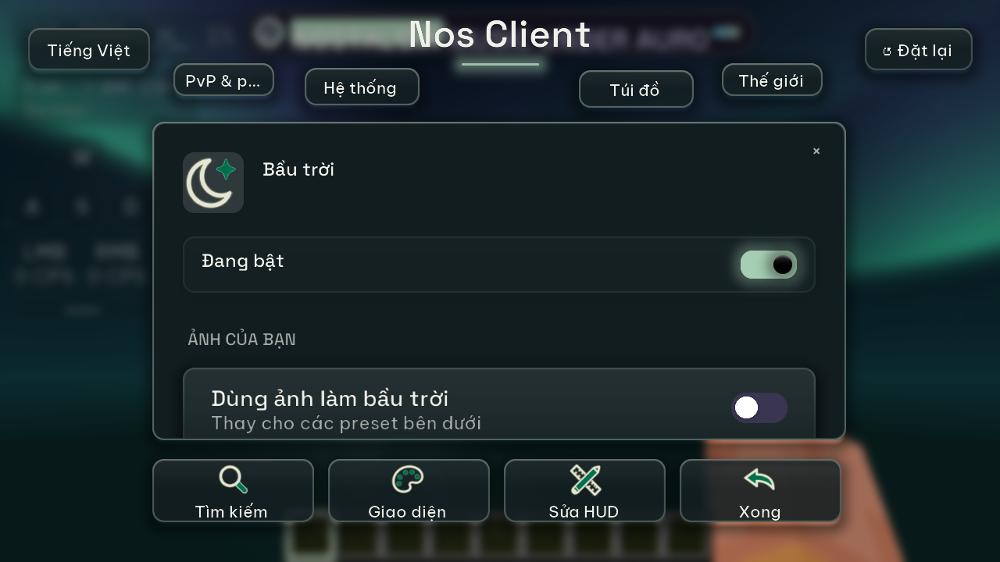
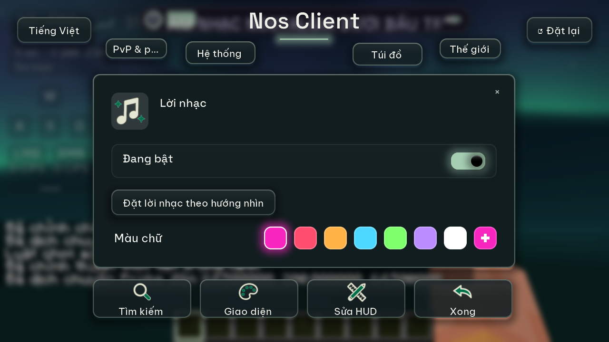
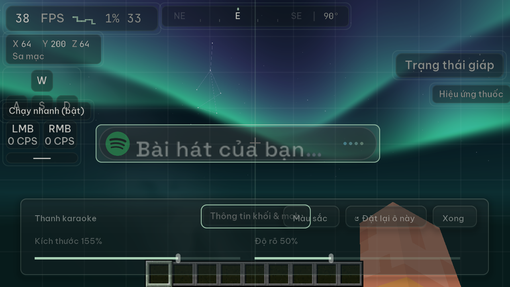

# QA Nos Client 0.4.0

Báo cáo này lưu kết quả trước khi gỡ cosmetic LF. Phạm vi và kết quả hiện tại ở
[QA lyrics và bầu trời](qa-lyrics-sky-only.md).

Ngày kiểm tra: 03–04/11/2026. Minecraft 1.21.11, Fabric Loader 0.19.5, Java 21, Linux.
Jar cuối: `nosclient-0.4.0.jar`.

SHA-256: `64a11db766134b6fc393ef97bd30c35086b22f9e680b584a48443f970d0bdbac`.

## Kết quả

- Build và 71 JUnit đạt, không bỏ qua ca nào. Kiểm 817 khóa dịch Việt/Anh và tham số định dạng.
- Shader core cùng các biến thể biên dịch được trên Mesa và NVIDIA; descriptor mixin khớp hai jar Minecraft đã map tên.
- Jar phát hành có một entrypoint, một mixin config; không chứa verifier hoặc namespace `lyricsflow`.
- FO không Iris: 58 ảnh của 29 preset ngày/đêm, 23 font, 9 trang hub; kiểm bấm/kéo, resize, phụ kiện,
  nhạc tắt nhưng bầu trời vẫn hiện, kéo/scale/opacity karaoke và khôi phục mây/mưa đều đạt.
- FO với Iris và Complementary Reimagined 5.9.3: 23 font, 9 trang hub, kéo/scale/opacity HUD,
  phím không trùng, resize và khôi phục mây/mưa đạt. Ảnh xác nhận preset Aurora và lời từng chữ
  hiện sau shaderpack; không còn lỗi thiếu pipeline Nos trong log.
- Jar cuối chạy hồi quy FO không Iris: 9 trang hub, thao tác, resize, phụ kiện, trời/lời và HUD đều đạt.
- Đối chiếu `options-loaded.txt` và `options.txt` ở các lượt đạt chỉ đổi cờ `startedCleanly` của Minecraft.
  Không đổi gamma, đồ họa, giới hạn FPS hoặc phím khác.
- Nguồn lời trực tuyến NetEase trả 46 dòng, 370 từ có mốc thời gian. Kiểm chỉ ghi số lượng, không lưu nội dung lời vào báo cáo.
- Player MPRIS trên D-Bus riêng qua phát/tạm dừng, tua tới/lùi, chuyển bài; vị trí đứng yên khi tạm dừng.
  Đọc nhạc vẫn hoạt động với `LD_LIBRARY_PATH` của launcher Linux 1.2.1 đóng gói.
- Ba phép mutation đều bị test phát hiện: bỏ guard revision của kết quả lời cũ, bỏ trần dữ liệu HTTP,
  bỏ kiểm mốc âm trong cache. Mã gốc được khôi phục và bộ test chạy lại đạt.

Vòng 58 ảnh preset chạy trước bản sửa phím và nhánh vẽ muộn Iris. Hình học, shader và tham số preset
không đổi; nhánh Iris được kiểm lại riêng với shaderpack. Lượt font Iris dùng jar cuối ghi ở đầu báo cáo.
Artifact của lượt FO không Iris: `8fe2916acce921041f3878f84e3f0351a9a93a1a82cf9c36a9550ac9ede47d70`.

## Hiệu năng đối chiếu

Máy AMD Ryzen 7 7735HS, renderer **llvmpipe LLVM 20.1.2**, Mesa 25.2.8; đây là dựng bằng CPU,
không phải số đo hiệu năng GPU NVIDIA/AMD. Cùng bản sao world, camera, 1280×720, view 8, simulation 5,
VSync tắt, cap 260. Mỗi lượt chờ 30 giây rồi lấy 30 mẫu một giây; không chạy đồng thời hai game/build.
Mọi lượt có `throttle=NONE`. Các khác biệt vài FPS có thể là nhiễu của môi trường.

| Bản/cảnh | Trung bình | Trung vị |
| --- | ---: | ---: |
| 0.3.1, tắt nhạc/trời | 103,93 | 104 |
| 0.4.0, tắt nhạc/trời | 108,67 | 110 |
| 0.4.0, chỉ đọc nguồn nhạc | 107,73 | 108 |
| 0.3.1, lời và Aurora Nos | 80,07 | 80 |
| 0.4.0, lời và Aurora Nos | 78,03 | 79 |
| 0.4.0, chỉ trời Aurora LF | 58,80 | 59 |
| 0.4.0, trời Aurora LF cùng lời | 53,53 | 54 |

Bầu trời LF có chi phí rõ trên llvmpipe; không suy diễn số này thành mức giảm FPS trên GPU thật.
Phần đọc nguồn nhạc không thể hiện chi phí lớn trong phép đo này. Các preset và hình ảnh LF được giữ
như đặc tả, không cắt hiệu ứng để làm đẹp số đo.

Artifact đo 0.4.0: `7d5f501227c8243ec2d29abd3c111459681aff1b8b107660cc529b26af470f0a`;
sau đó sửa phím mặc định và nhánh vẽ muộn khi có shaderpack. Bảng ghi đúng artifact đã đo,
không dùng các số này để khẳng định hiệu năng nhánh Iris mới. Baseline 0.3.1 lấy từ release công khai, SHA-256
`76eb92bb5e271006e95bf0528266a610875303f4929835d1dd15754e7f69d8b5`.

## Ảnh kiểm tra

[29 preset đêm](qa-0.4.0/night-sheet.png), [29 preset ngày](qa-0.4.0/day-sheet.png),
[23 font](qa-0.4.0/fonts-sheet.png), [23 font với Complementary](qa-0.4.0/iris-fonts-sheet.png). Ảnh chụp từ framebuffer game thật; contact sheet chỉ thu nhỏ và ghi nhãn.

## Giới hạn kiểm chứng

Windows có build/JUnit trên CI; chưa chạy SMTC hay đăng nhập Spotify thực trên máy Windows/macOS.
Callback Spotify được kiểm bằng socket loopback thật với state/path/duplicate/timeout/cancel.
Các lượt game dùng tài khoản offline nên có lỗi xác thực Realms/401 dự kiến; Xvfb không có thiết bị âm thanh.
Không dùng các thông báo đó làm bằng chứng lỗi của Nos.

Hai lượt Complementary đầu bị `earlyoom` gửi SIGTERM khi RAM khả dụng dưới 10% (RSS JVM khoảng
3,5–3,75 GiB), không có báo cáo crash Java. Không tính các lượt đó là đạt. Lượt xác nhận cuối
dùng heap 1.536 MiB, 4 luồng CPU/llvmpipe để kiểm hiển thị mà không bị giới hạn RAM; không lấy FPS
của lượt đó làm phép đo so sánh. Bộ kiểm chờ các khung hình và cuộn ổn định trước khi thao tác.

Hướng dẫn chạy lại: [checks/README.md](../checks/README.md). Các log/options/config và từng ảnh đầy đủ
được giữ trong thư mục kiểm thử riêng `nos-verification`; không đưa save hoặc cấu hình cá nhân vào Git.

## CI và artifact bàn giao

[CI trên Linux/Windows](https://github.com/JunXmas/nos-client/actions/runs/41758011318) đạt cho
commit `d76253b1d1de2dcb2b7314abaa40e3af6dc026fb`, gồm build, 71 JUnit, localization và biên dịch verifier.

Jar CI Linux có SHA-256 `0e5b4ed1d51684057fdb86388b5cae78db8853ba1701c78aed7a836f6e227475`.
Đối chiếu ZIP cho thấy tất cả entry giống nhau, chỉ `Pages$1.class` khác chỉ số trong constant pool;
các lệnh bytecode sau phân giải trùng nhau. Gói bàn giao dùng **jar đã chạy QA thật** với SHA-256 ở đầu
báo cáo, đổi tên thành `nos-client-0.4.0.jar` theo tiền tố launcher nhận diện. Chưa tạo tag/phát hành.
