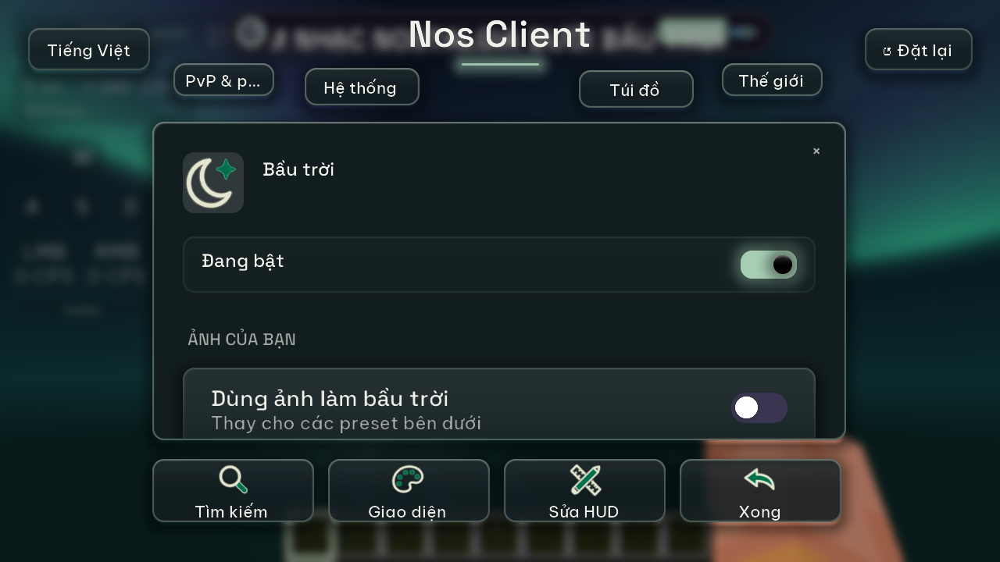
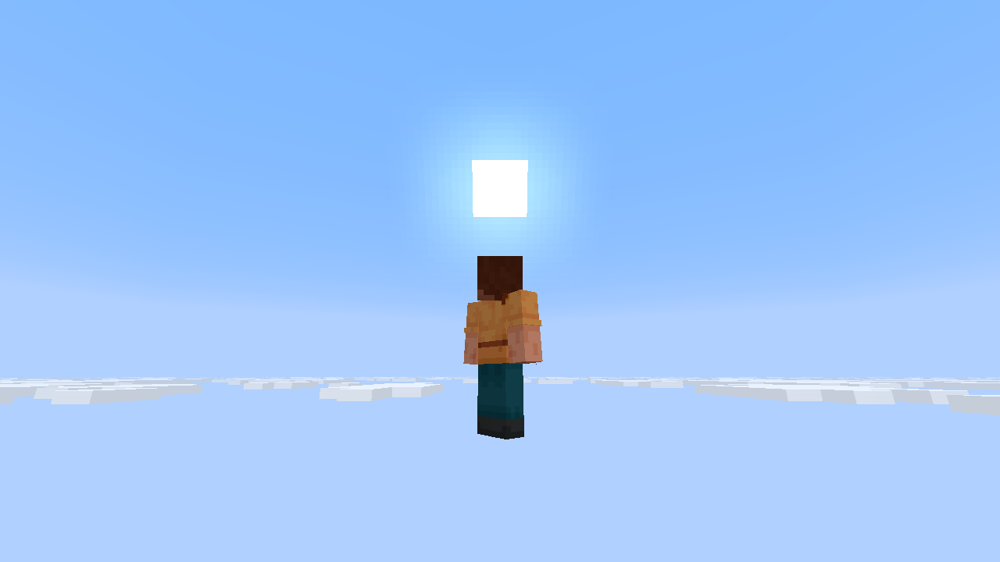
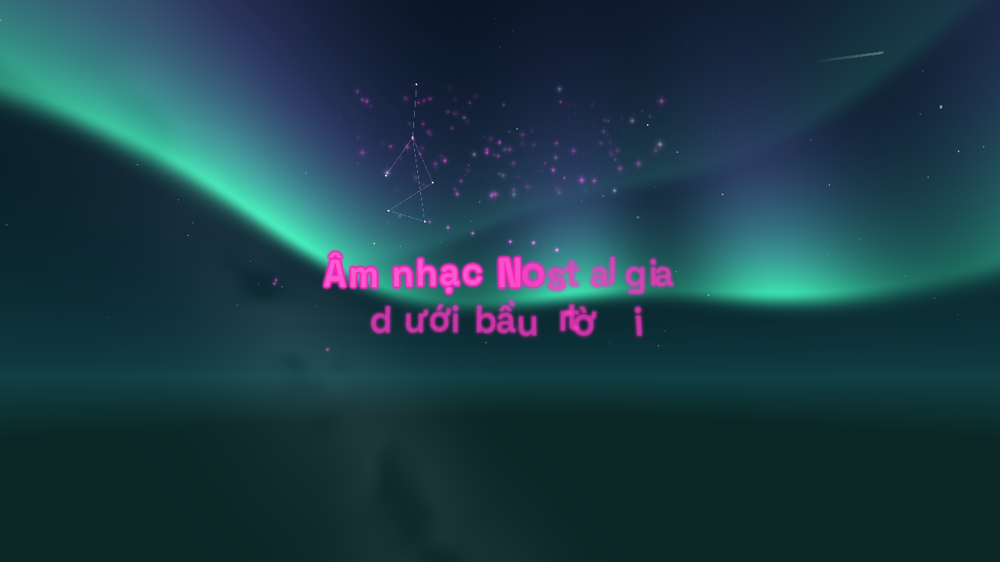

# QA Nos Client: nhạc, lời và bầu trời

Báo cáo này lưu artifact 0.4.0 trước khi ưu tiên lyrics LF. Kết quả mới ở [QA lyrics LF](qa-lyricsflow.md).

## Artifact 0.4.0 chạy Minecraft

Ngày kiểm tra: 04/11/2026. Minecraft 1.21.11, Fabric Loader 0.19.5, Java 21, Linux.
Jar: `nosclient-0.4.0.jar`.

SHA-256: `cacc4aff11869efa3ec80898b2ae664d020edc106387f7af8cb084ba54ef0d42`.

## Phạm vi thay đổi

- Giữ nguồn nhạc, lời từng chữ, karaoke, lời trên trời và các preset bầu trời.
- Gỡ mã, đăng ký render, mixin, giao diện, cấu hình và tài nguyên cosmetic/hiệu ứng chết của LF.
- Cấu hình LF cũ được bỏ qua và xóa khi lưu lại; cài đặt nhạc/bầu trời được bảo toàn.
- Bỏ trang ghi công riêng và trường contributor trong metadata. Thông báo bản quyền, MIT và giấy phép
  font được giữ trong jar. Điều khoản Nos chỉ áp dụng cho phần mã/tài nguyên Nos sở hữu.

Thư viện cosmetic Nos có từ trước vẫn bị tắt; bản này không triển khai cửa hàng hoặc quyền sở hữu
cosmetic trong game.

## Kết quả trên artifact hiện tại

- Build và 72 JUnit đạt: không lỗi, không bỏ qua bài nào. Có ca hồi quy nạp/lưu cấu hình cosmetic cũ
  và xác nhận lời/font/preset không bị đổi.
- Kiểm localization đạt: 774 khóa tiếng Việt/Anh cùng tham số định dạng.
- Kiểm nội dung jar đạt: không còn lớp/tài nguyên LF đã gỡ hoặc verifier; có thông báo MIT và font.
- FO không Iris đạt: 8 trang hub có thao tác bấm/kéo/cuộn thực, cửa sổ nhỏ/lớn, trình phát, lời trôi nổi,
  nhân vật vanilla, lời từng chữ trên trời, kéo/scale/opacity karaoke, bảo toàn mây/mưa và phím media.
- Lượt đầy đủ FO không Iris đạt trên cùng SHA-256: 58 ảnh của 29 preset ngày/đêm, 23 font và toàn bộ
  8 trang hub cùng các ca hồi quy nêu trên. Đã kiểm ảnh ngày/đêm và nhân vật sau khi gỡ cosmetic.
- FO với Iris và Complementary Reimagined 5.9.3 LOW đạt cùng phạm vi hồi quy 8 trang hub.
  Ảnh xác nhận bầu trời và lời vẫn hiện sau shaderpack. Heap 768 MiB, 4 luồng JVM, 2 luồng llvmpipe;
  dùng để kiểm chức năng, không làm số đo FPS.
- Cấu hình sau game không còn các trường cosmetic LF. Đối chiếu tùy chọn Minecraft chỉ đổi
  `startedCleanly` từ `false` sang `true`.

Log và ảnh gốc của lượt đạt ở `nos-verification/lyrics-sky-only-native/` và
`nos-verification/lyrics-sky-only-iris-low/`; lượt đầy đủ ở `nos-verification/lyrics-sky-only-full/`.
Các lượt dùng D-Bus, save,
game directory, cấu hình và JVM home riêng; không điều khiển player hoặc sửa world thật.

## Iris và giới hạn kiểm chứng

Hai lượt Complementary HIGH mới và một lượt đối chiếu với jar cũ bị `earlyoom` gửi SIGTERM khi
RAM khả dụng xuống dưới 10%; journal hệ thống ghi PID và RSS JVM khoảng 3,5–3,8 GiB. Hai lượt mới
còn ghi SIGSEGV trong `libLLVM.so.20.1` ngay sau SIGTERM. Không tính các lượt này là đạt.
Lượt LOW nêu trên hoàn tất sau khi giảm áp lực RAM trong môi trường riêng. Chưa kiểm lại HIGH
trên artifact hiện tại với đủ RAM hoặc GPU thật.

Chưa chạy SMTC hoặc đăng nhập Spotify thực trên Windows/macOS. Game QA dùng tài khoản offline;
401/Realms và thiếu thiết bị âm thanh trong Xvfb được ghi trong log.

## CI và gói bàn giao

[CI Linux/Windows](https://github.com/JunXmas/nos-client/actions/runs/41768062294) đạt cho commit
`9c2ce43a654d5a2c49d659204de96bb5384c58b9`: build, 72 JUnit, localization và biên dịch verifier.
Jar tải từ CI Linux trùng từng byte với jar chạy game, cùng SHA-256 ở đầu báo cáo.
Gói bàn giao dùng jar đã chạy Minecraft thật với SHA-256 ở đầu báo cáo, đổi tên thành
`nos-client-0.4.0.jar` theo tiền tố launcher nhận diện.

## Ảnh kiểm tra

Bản tích hợp trước có báo cáo [QA 0.4.0](qa-0.4.0.md), gồm 58 ảnh preset ngày/đêm, 23 font,
MPRIS, nguồn lời trực tuyến, kiểm shader/mixin và số đo hiệu năng. Các kết quả đó được giữ theo đúng
artifact đã đo, không gán cho jar hiện tại.

Hướng dẫn chạy lại: [checks/README.md](../checks/README.md).
