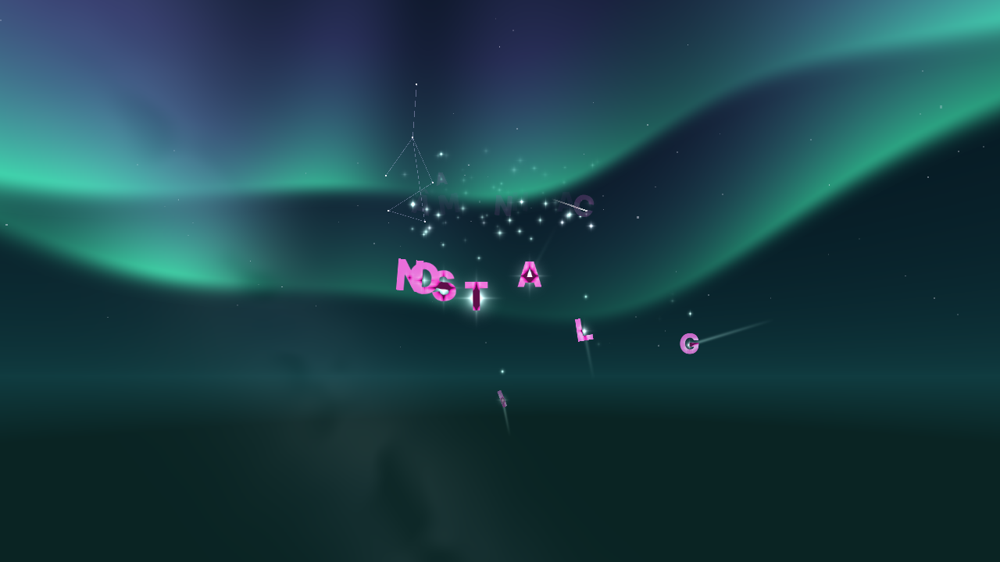

# QA lyrics LF và Nos

## Bản vá 0.4.2: Nos mặc định

Kiểu mặc định và giá trị dự phòng khi thiếu/hỏng cấu hình là `NOS_SKY`, font `nos-celestial`.
Đặt lại lyrics/kiểu chữ dùng các giá trị mặc định này; lựa chọn hợp lệ đã lưu hoặc nhập từ profile
vẫn được giữ nguyên, gồm cả hai kiểu LF.

Build, 73 JUnit và 788 khóa dịch đạt. SHA-256 jar 0.4.2:
`c92596a48f4a198d0aaa6fbc70d471ed76f8f44aa7a16ee5b5417667f841418d`.
So với 0.4.1, các lớp renderer và tài nguyên trùng từng byte. Ngoài lớp cấu hình mặc định,
chỉ đổi metadata/chuỗi phiên bản; lớp switch sinh tự động chỉ khác chỉ số constant pool,
bytecode sau phân giải giống nhau. Không chạy lại Minecraft cho thay đổi mặc định này;
các lượt game dưới đây dùng artifact 0.4.1.

## Artifact 0.4.1 chạy Minecraft

Ngày kiểm tra: 04/11/2026. Minecraft 1.21.11, Fabric Loader 0.19.5, Java 21, Linux.
Artifact 0.4.1: `nosclient-0.4.1.jar`.

SHA-256: `ffd4a7daca67b45209218263e793d5e3efb0c9b87d545b3886aa630b0ab1f1e8`.

## Phạm vi

| Lựa chọn | Cách hiển thị và tùy chỉnh |
| --- | --- |
| Trên trời, mặc định | LF: câu ghép cặp hoặc rải từng từ; bố cục cong, cỡ từ, hiệu ứng vào/ra, font, màu và quầng sáng. |
| Trôi nổi | LF: từ xuất hiện trong thế giới; cự ly, độ cao, vị trí và hiệu ứng. |
| Trên trời Nos | Giữ renderer và các thiết lập bố cục, chuyển động, màu, hướng của Nos. |

Ba lựa chọn dùng chung nguồn nhạc, dữ liệu lời, mốc từng từ và độ lệch thời gian. Kiểu Nos giữ riêng;
chỉ renderer được chọn mới vẽ. Mặc định font lyrics LF là Poppins; font và thiết lập Nos đã lưu được giữ.

Hub giữ một nơi chỉnh cho mỗi chức năng chính. Trang Lyrics chứa kiểu hiển thị, cỡ, đồng bộ và tải lời;
trang kiểu chữ chỉnh font/diện mạo; trang đang phát chỉnh nguồn nhạc và kết nối. Bỏ các nút bật/tắt trùng
với header, bỏ nút bật lyrics trên trang kiểu chữ và chỉ hiện tùy chỉnh phù hợp với renderer đang chọn.

Thông báo bản quyền Nos chỉ dùng tên JunXmas. Điều khoản Nos, thông báo MIT của LF và giấy phép font
được giữ; không đưa lại cosmetic hoặc hiệu ứng chết của LF.

## Kiểm chứng

- Build và 73 JUnit đạt, không lỗi hoặc bỏ qua ca nào. Kiểm profile mới/cũ giữ đúng ba kiểu lyrics,
  font, offset, hiệu ứng và khóa theo góc nhìn sau xuất/nhập.
- Localization đạt 788 khóa tiếng Việt/Anh và tham số định dạng.
- Kiểm jar đạt: một entrypoint, không có verifier hoặc cosmetic LF đã gỡ; có LICENSE và notices.
- FO không Iris trên jar cuối đạt 8 trang hub có bấm/kéo/cuộn thực, đổi qua cả ba lựa chọn bằng click,
  resize, HUD karaoke, phím media và khôi phục mây/mưa. Kiểm tự động từ chối điều khiển chính bị lặp.
- Các cảnh LF câu ghép cặp, LF rải từ, Nos, khóa theo góc nhìn và chữ gọn được chụp từ framebuffer.
  Kiểm trạng thái LF và số khung Nos để phát hiện renderer thiếu hoặc vẽ chồng.

Lượt rộng hơn trên FO không Iris và Iris/Complementary Reimagined 5.9.3 LOW đều đạt 23 font và 8 hub,
với artifact `d8a003cd09b04851fc780b7000ca33015241f3f861d64b2ea8220c680c5cc5ea`.
Sau lượt đó sửa điều kiện tắt glow, tinh gọn liên kết dịch vụ và giới hạn slider theo kiểu hiển thị;
lượt hồi quy jar cuối không lặp lại toàn bộ font. Không gán kết quả font cũ cho artifact khác.

Jar cuối cũng đạt lượt hồi quy FO với Iris/Complementary LOW: 8 hub, cả ba lựa chọn, các cảnh lyrics,
resize, HUD và bảo toàn mây/mưa. Đối chiếu tùy chọn Minecraft của hai lượt cuối chỉ thay
`startedCleanly` từ `false` sang `true`.

Log/ảnh gốc: `nos-verification/lf-lyrics-native`, `lf-lyrics-iris`, `lf-lyrics-native-final` và
`lf-lyrics-iris-final-stable`. Các lượt dùng D-Bus, save, game directory, cấu hình và JVM home riêng.
Không điều khiển player hoặc sửa world/config game thật.

## Ảnh kiểm tra

## Giới hạn

Các lượt game dùng llvmpipe, heap 768 MiB, 4 luồng JVM và 2 luồng rasterizer để tránh áp lực RAM.
Không dùng FPS của môi trường này để kết luận hiệu năng GPU thật. Chưa kiểm shader HIGH trên artifact
này. Không chạy SMTC hoặc đăng nhập Spotify thật trên Windows/macOS.

Không tính hai lượt Iris cuối bị thiếu RAM là đạt: `earlyoom` dừng JVM khi RAM máy dưới 10%;
lượt giảm heap còn 512 MiB gặp Java OutOfMemoryError. Sau khi dừng daemon build để giải phóng RAM,
lượt `lf-lyrics-iris-final-stable` dùng lại heap 768 MiB và hoàn tất. Không đổi cấu hình game thật.

Lượt 29 preset ngày/đêm và các phép đo cũ được giữ đúng artifact tại
[QA 0.4.0](qa-lyrics-sky-only.md). `WorldSky.class` của jar mới trùng từng byte với 0.4.0 phát hành;
thay đổi này tập trung vào lyrics và điều khiển hub.

Game QA dùng tài khoản offline, có lỗi Realms/401 và thiếu thiết bị âm thanh trong Xvfb được ghi trong log.
Hướng dẫn chạy lại: [checks/README.md](../checks/README.md).
